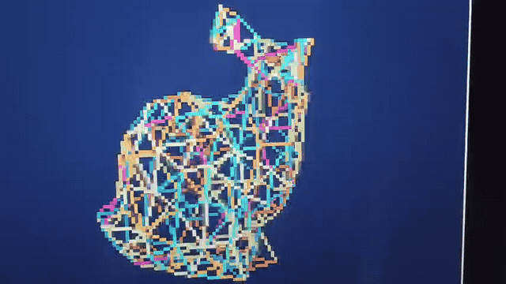

# Tang Nano 9K: Real-Time 3D Stanford Bunny Wireframe Engine



A real-time 3D wireframe graphics engine running on the **Sipeed Tang Nano 9K** (Gowin GW1NR-9C FPGA), generating **640x480 @ 60Hz HDMI/DVI video output**.

Built using a **100% open-source toolchain** (Yosys, nextpnr-himbaechel, Apicula, openFPGALoader). **No vendor Gowin EDA license required.**

---

## Highlights

- **Zero External RAM Required**: Runs entirely on the FPGA's on-chip Block SRAM (BSRAM). No PSRAM or external SDRAM needed.
- **High-Density Mesh**: 128 vertices and 377 edges derived from the canonical Stanford Bunny with 4 anatomical color regions (Ears, Head, Body, Feet).
- **Smooth 60 FPS Animation**: Real-time 360° Yaw rotation with continuous painter's depth sorting (pass 0: shaded back-edges, pass 1: neon front-edges).
- **Hardware Bresenham Rasterizer**: Fast integer line rasterizer completing a full frame in ~0.80ms (far below the 16.6ms 60Hz frame budget).
- **Integer 4x4 Scaler**: Double-buffered 160x120 4-bit palette buffer (10 BSRAM DPB blocks) upscaled on-the-fly to standard 640x480 @ 60Hz HDMI.
- **Architectural Breakthrough**: Duplicated BSRAM arrays for transformed vertex storage, eliminating 128:1 multiplexer trees and slashing logic cell utilization by **60%** (fitting easily into Gowin GW1N-9C).
- **Complete Test Suite**: 7/7 automated bit-level regression tests (including full-frame RTL simulation with PPM output verification).

---

## Resource Utilization (Gowin GW1NR-LV9QN88PC6/I5)

| Resource | Used | Available | Utilization |
|---|---|---|---|
| **Logic Cells** | 3,156 | 8,640 | **~36%** |
| **LUT4** | 1,506 | 8,640 | **~17%** |
| **DFF Registers** | 476 | 6,480 | **~7%** |
| **Block RAM (BSRAM)** | 14 blocks | 26 blocks | **~53%** |
| **Pixel Clock Fmax** | **57.55 MHz** | 30.00 MHz target | **PASS (+27.5 MHz slack)** |
| **HDMI Serializer Clock Fmax** | **231.16 MHz** | 30.00 MHz target | **PASS (+201.1 MHz slack)** |

---

## Hardware Requirements

- **FPGA Board**: [Sipeed Tang Nano 9K](https://wiki.sipeed.com/hardware/en/tang/Tang-Nano-9K/Nano-9K.html) (Gowin GW1NR-9C)
- **Display**: Any standard HDMI / DVI monitor or TV supporting 640x480 @ 60Hz
- **Connection**: USB-C cable for programming and power (plug directly to the board's USB-C port)

---

## Toolchain Setup

This project uses the modern, multi-platform [YosysHQ OSS CAD Suite](https://github.com/YosysHQ/oss-cad-suite-build).

```bash
# Download and unpack OSS CAD Suite (example for Linux x64):
wget https://github.com/YosysHQ/oss-cad-suite-build/releases/download/2026-10-09/oss-cad-suite-linux-x64-20261009.tgz
tar -xzf oss-cad-suite-linux-x64-20261009.tgz -C ~/

# Add to PATH (or set TOOLCHAIN_PATH in Makefile):
export PATH=~/oss-cad-suite/bin:$PATH
```

---

## Quick Start

### 1. Run Verification Tests
Before touching hardware, verify the entire RTL pipeline with automated tests:

```bash
make test
```

This runs:
- Pure math & LUT accuracy verification (`test_rot_golden.py`)
- Hardware Bresenham algorithmic correctness (`test_bresenham.py`)
- Full RTL frame rasterization & color palette sanity check (`test_rtl_bunny_frame.py`)
- DVI/TMDS encoding DC balance & disparity (`test_tmds_golden.py`, `test_rtl_tmds.py`)
- HDMI scanout timings (`test_scanout_timing.py`)

### 2. Build Bitstream
Synthesize with Yosys and place-and-route with `nextpnr-himbaechel`:

```bash
make
```

Outputs: `bunny_bram.fs`

### 3. Flash to Board
Flash to on-board SPI Flash (persistent across reboots):

```bash
make flash
```

Or load directly into FPGA volatile SRAM (instant test):

```bash
make flash-sram
```

---

## Key Lessons & Hardware Caveats

During development, several critical Gowin/OSS EDA edge cases were diagnosed and solved:

1. **Yosys Gowin DSP Mapping Bug (`-nodsp`)**:
   Synthesizing `*` operators into Gowin `MULT18X18` primitives in Yosys caused disconnected A-side operands and broken signed handling. Specifying `-nodsp` forces LUT-based multiplication and shift-add projection math, which runs completely glitch-free.
2. **Fabric Clock Divider Jitter**:
   Dividing the 126 MHz serializer clock by 5 in fabric logic creates phase jitter that violates Gowin `OSER10` serializer specs, causing black screens on many TVs. Using the dedicated `Gowin_CLKDIV (DIV_MODE=5)` primitive provides a rock-solid, low-jitter pixel clock.
3. **P&R Routing Congestion**:
   On high-utilization designs, random routing can cause clock nets to fall back to general routing. Setting `SEED ?= 3` in `nextpnr` guarantees zero dedicated clock routing warnings and clean PLL lock.
4. **BSRAM Duplication**:
   Storing transformed 2D coordinates in discrete registers creates 2,000+ flip-flops and huge 128:1 multiplexer trees, exceeding Gowin slice packing limits. Duplicating the array across two dual-port BSRAM blocks (`vert_data_0`, `vert_data_1`) allows simultaneous single-cycle access to both edge endpoints with zero multiplexer overhead.

---

## License

MIT License. See [LICENSE](LICENSE) for details.

## Acknowledgments

- **Stanford Bunny**: The 3D Stanford Bunny model is courtesy of the Stanford University Computer Graphics Laboratory ([Stanford 3D Scanning Repository](http://graphics.stanford.edu/data/3Dscanrep/)).
- **Open-Source FPGA Toolchain**: Synthesized and routed using [Yosys](https://github.com/YosysHQ/yosys), [nextpnr-gowin](https://github.com/YosysHQ/nextpnr), and [Apycula](https://github.com/YosysHQ/apicula) from the [YosysHQ OSS CAD Suite](https://github.com/YosysHQ/oss-cad-suite-build).
